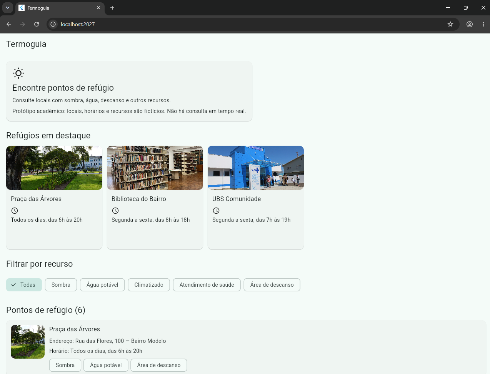
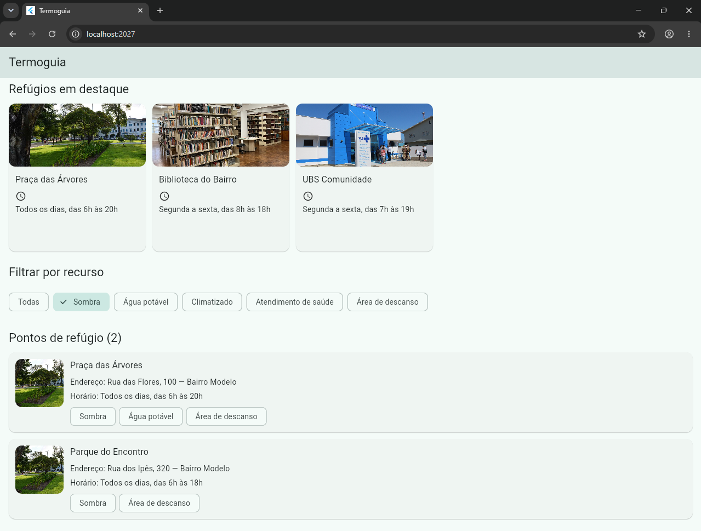
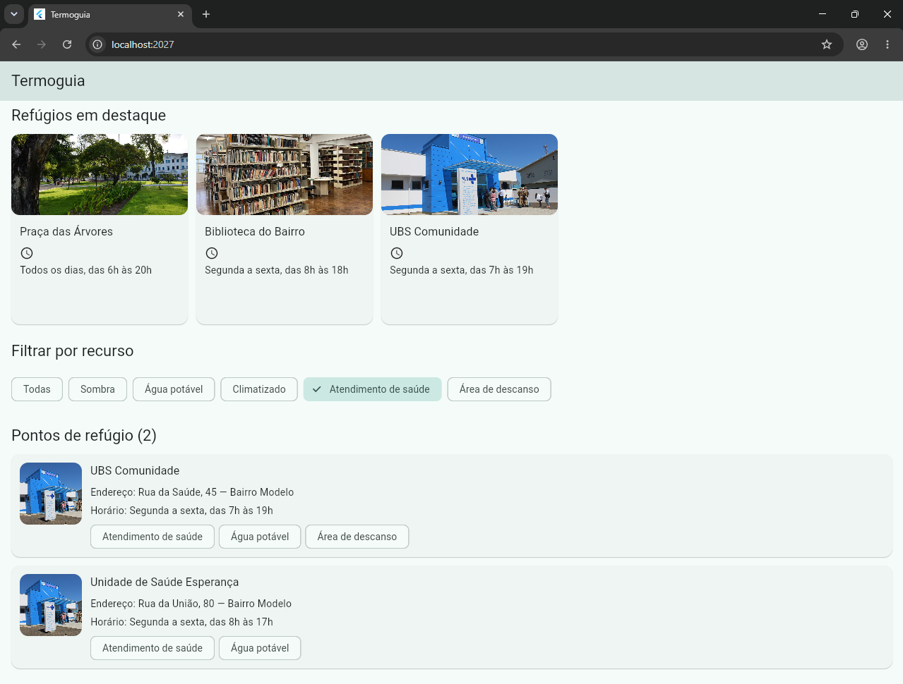

# Termoguia

Aplicativo desenvolvido em Flutter para consulta de pontos de refúgio contra o calor.

## 1. Tema da Global Solution

CitizenTech — tecnologia a serviço do cidadão.

O Termoguia está relacionado à proteção da população contra ondas de calor, com foco na consulta de locais que oferecem recursos como sombra, água potável e áreas de descanso.

## 2. Descrição da solução

O Termoguia permite consultar pontos de refúgio e filtrar os locais pelos recursos disponíveis.

A proposta busca apoiar a identificação de espaços de acolhimento durante períodos de calor, considerando públicos como idosos, cuidadores, trabalhadores ao ar livre e outros moradores.

Nesta versão acadêmica, todos os locais, endereços, horários e recursos apresentados são fictícios e utilizados apenas para demonstrar o funcionamento do aplicativo.

As informações não são verificadas em tempo real e não devem ser utilizadas para orientar deslocamentos reais.

## 3. Funcionalidades implementadas

- Lista vertical com seis pontos de refúgio.
- Exibição de imagem, nome, endereço e horário de cada local.
- Filtro horizontal por categorias.
- Opção "Todas" para restaurar a lista completa.
- Destaque visual da categoria selecionada.
- Lista horizontal com três pontos em destaque.
- Possibilidade de um ponto pertencer a várias categorias.
- Atualização da interface utilizando setState.
- Componentes visuais personalizados e reutilizáveis.
- Dados locais centralizados em um repositório.

### Categorias disponíveis

- Sombra.
- Água potável.
- Climatizado.
- Atendimento de saúde.
- Área de descanso.

### Comportamento dos destaques

A seleção de uma categoria altera apenas a lista principal.

A seção de destaques continua apresentando os três pontos definidos como destaque no repositório.

## 4. Fluxo de telas

O aplicativo possui uma tela principal com o seguinte fluxo:

1. O usuário abre o Termoguia.
2. Visualiza a apresentação e o aviso de dados fictícios.
3. Consulta os pontos de refúgio em destaque.
4. Seleciona uma categoria na lista horizontal.
5. A lista principal é atualizada conforme a seleção.
6. O contador apresenta a quantidade de pontos encontrados.
7. Ao selecionar "Todas", os seis pontos voltam a ser exibidos.

## 5. Prints das telas

### Tela inicial



### Filtro por sombra



### Filtro por atendimento de saúde



## 6. Tecnologias utilizadas

- Flutter.
- Dart.
- Material Design 3.
- Flutter Test.
- Imagens locais carregadas com Image.asset.

## 7. API utilizada

Nenhuma API externa foi utilizada nesta versão.

Os registros são fictícios e ficam armazenados em memória na classe RefugeRepository.

## 8. Arquitetura

O projeto está organizado com separação entre modelos, repositório, tela e componentes visuais.

### models/

Contém as estruturas que representam os dados do aplicativo:

- RefugePoint: classe que representa um ponto de refúgio.
- RefugeCategory: enum que representa as categorias.

Cada ponto possui nome, endereço, horário, imagem, lista de categorias e um atributo booleano que indica se é destaque.

### repositories/

Contém a classe RefugeRepository, responsável por centralizar os dados e disponibilizar os métodos:

- getAll(): retorna todos os pontos.
- getByCategory(): retorna os pontos da categoria selecionada.
- getFeatured(): retorna os pontos marcados como destaque.

As regras de filtragem ficam no repositório, separadas dos métodos de construção da interface.

### screens/

Contém a HomeScreen, responsável pela tela principal e pelo estado da categoria selecionada.

A atualização da interface é realizada com setState.

### widgets/

Contém os componentes personalizados:

- RefugeImage: apresenta as imagens dos locais.
- RefugeListTile: apresenta os registros da lista principal.
- CategorySelector: apresenta as categorias selecionáveis.
- FeaturedRefugesSection: organiza a seção de destaques.
- FeaturedRefugeCard: apresenta cada ponto em destaque.

## 9. Estrutura do projeto

```text
termoguia/
├── assets/
│   └── images/
│       ├── praca.jpg
│       ├── biblioteca.jpg
│       └── unidade_saude.jpg
├── docs/
│   └── images/
│       ├── tela-inicial.png
│       ├── filtro-sombra.png
│       └── filtro-saude.png
├── lib/
│   ├── main.dart
│   ├── models/
│   │   ├── refuge_category.dart
│   │   └── refuge_point.dart
│   ├── repositories/
│   │   └── refuge_repository.dart
│   ├── screens/
│   │   └── home_screen.dart
│   └── widgets/
│       ├── refuge_image.dart
│       ├── refuge_list_tile.dart
│       ├── category_selector.dart
│       └── featured_refuges_section.dart
├── test/
│   └── widget_test.dart
├── pubspec.yaml
└── README.md
```

## 10. Como executar

### Pré-requisitos

- Flutter SDK instalado.
- Dart compatível com o requisito definido no pubspec.yaml.
- Chrome para execução web ou um dispositivo/emulador configurado para execução mobile.

### Instalar as dependências

Dentro da pasta principal do projeto:

```bash
flutter pub get
```

### Executar no Chrome

```bash
flutter run -d chrome
```

### Listar dispositivos disponíveis

```bash
flutter devices
```

### Executar em um dispositivo específico

Substitua ID_DO_DISPOSITIVO pelo identificador mostrado no comando anterior:

```bash
flutter run -d ID_DO_DISPOSITIVO
```

## 11. Verificações realizadas

Foram executados os seguintes comandos:

```bash
dart format lib test
flutter analyze
flutter test
flutter build web
```

Resultados obtidos:

- Código formatado.
- Análise estática sem problemas reportados.
- Um teste de widget aprovado.
- Build web gerado com sucesso.

O teste de widget verifica a exibição inicial de seis pontos e a filtragem por sombra, com dois resultados.

Essas verificações não substituem a revisão visual nem os testes em dispositivos mobile.

## 12. Limitações e melhorias futuras

Esta versão não possui:

- Dados reais de pontos de refúgio.
- Confirmação de abertura dos locais em tempo real.
- Consulta de temperatura em tempo real.
- Mapa interativo.
- Geolocalização.
- Cálculo de rotas com sombra.
- Envio de mensagens por WhatsApp ou SMS.
- Cadastro e acompanhamento de usuários.

Esses recursos poderão ser considerados em futuras versões, com validação dos dados e das necessidades dos usuários.

## 13. Desenvolvedores

| Gabriel Imperio Parizotto | 560551 |
|---|---|
| Gabriel Matos Marques Rosa | 559931 |


## 14. Créditos das imagens

Informar a origem, autoria e licença ou autorização de uso das imagens:

- Praça: (https://turismo.joaopessoa.pb.gov.br/o-que-fazer/pontos-turisticos/pracas-e-parques/praca-da-independencia/)
- Biblioteca: https://www.apm.org.br/sociocultural/espacos-culturais/biblioteca/
- Unidade de saúde: https://laguna.sc.gov.br/noticia-578089/